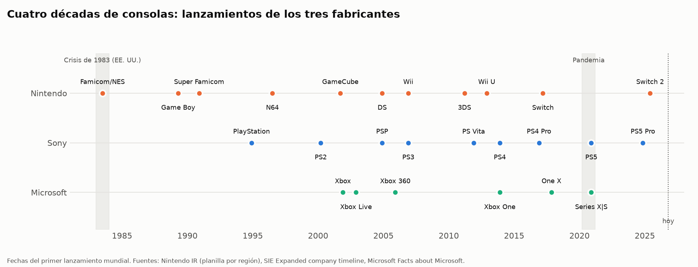
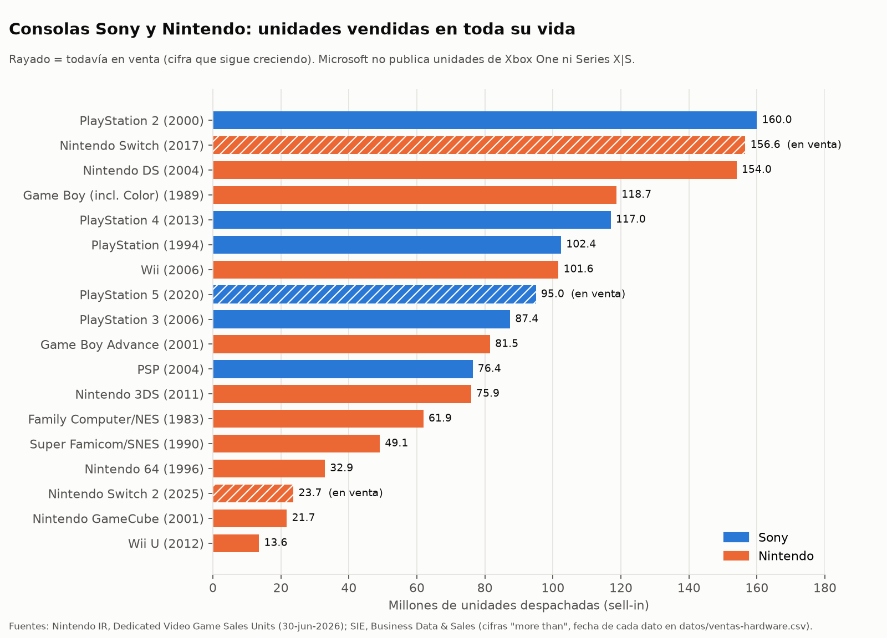
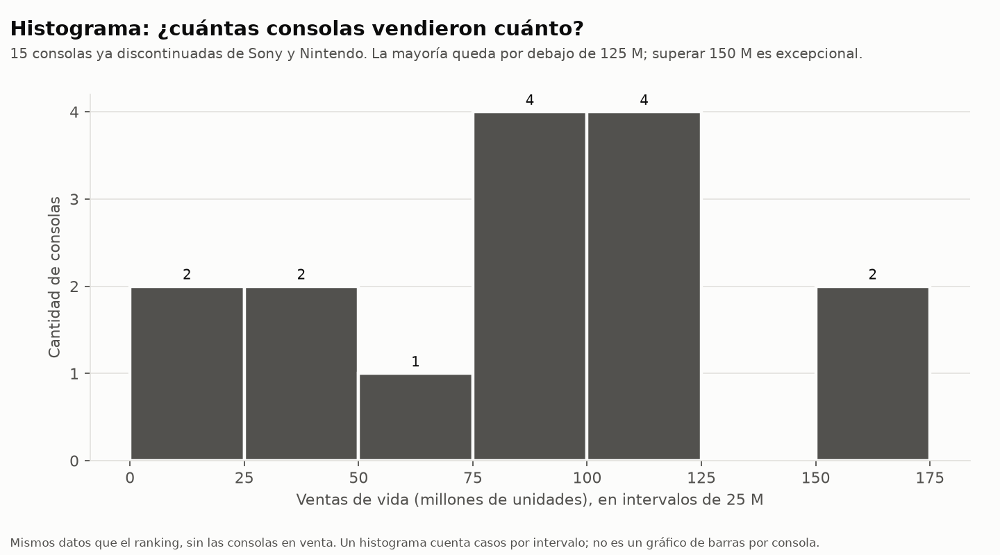
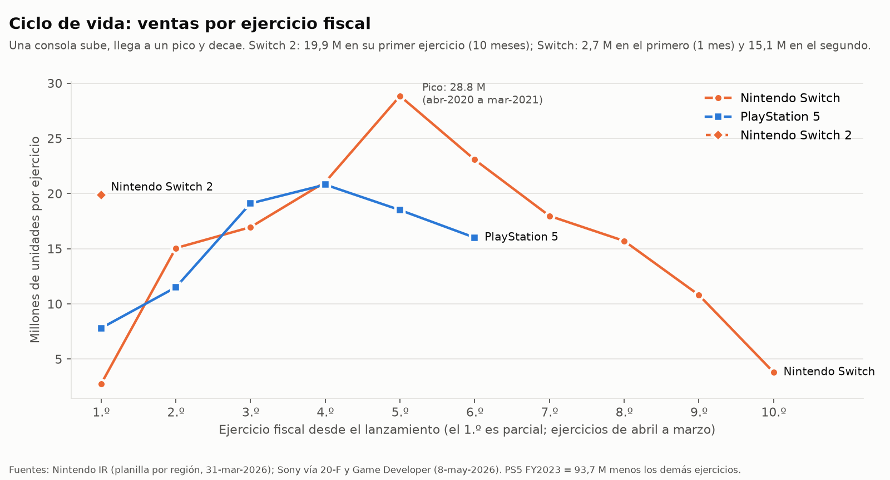
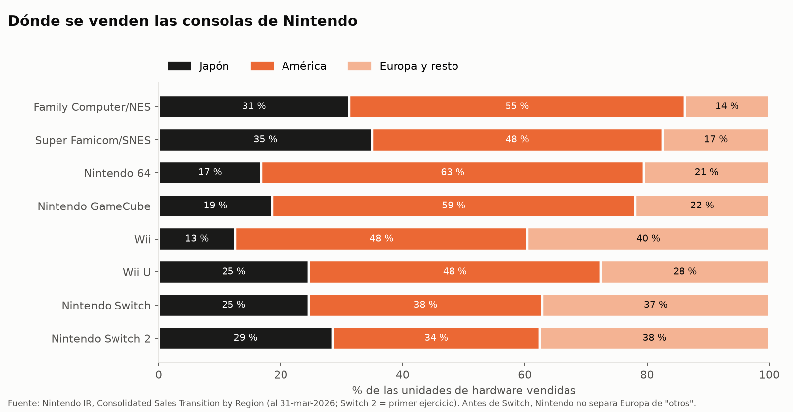
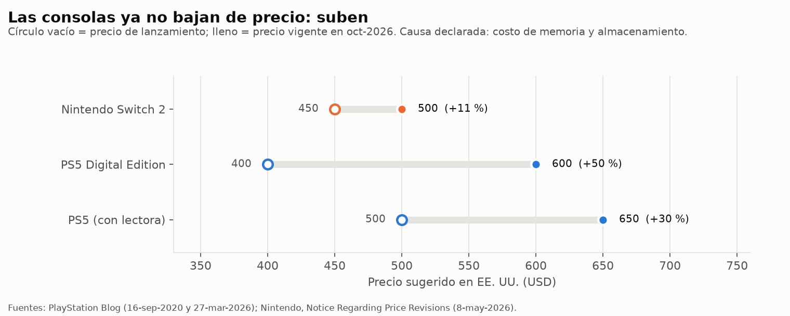

# Unidad 5: Diseño según plataforma de consolas (desarrollo del tema)

Cátedra: Diseño según Plataformas de Juego (UNJu). Motor: Unity 6000.3.11f1.
Fecha de los datos: **verificados el 2026-10-24**. Estado del documento: **PROPUESTO**. Es material de desarrollo teórico; las slides definitivas se escriben después de que se apruebe la arquitectura de la unidad (regla 13 de `CONTINUAR.md`).

Complementa a `00-investigacion-preliminar.md`, que cubre certificación, mandos, accesibilidad, multijugador y optimización. Este documento agrega lo que faltaba: **las distintas consolas, su historia, los datos de ventas y de mercado, y qué decisiones de diseño se desprenden de esos datos**.

**Convenciones**
- **HECHO**: lo dice una fuente oficial o verificada. El ID entre corchetes remite a `datos/fuentes.md` (por ejemplo [N1]) o a una ficha de la investigación preliminar (por ejemplo [B-27]).
- **INFERENCIA**: conclusión propia a partir de los datos. Se marca siempre.
- **Conocimiento general**: dato histórico ampliamente aceptado que **no** se verificó con una fuente oficial en esta investigación. Sirve para contar la historia; no se usa como cifra.
- Todas las ventas de hardware son **sell-in**: unidades que el fabricante despachó a los comercios, no consolas compradas por jugadores.
- Los gráficos se regeneran con `python scripts/graficos_consolas.py` a partir de los CSV de `datos/`.

---

## 1. El problema de apertura

> Tu equipo terminó *Asteroides* para PC y Android. Un publisher les ofrece llevarlo a consola, pero solo financia **una** plataforma este año: PS5, Xbox Series X|S o Nintendo Switch 2. ¿Cuál eligen y qué tienen que cambiar del juego?

Con lo que sabemos de PC y móvil, el primer impulso es responder "la que más vendió". Este documento muestra por qué esa respuesta es incompleta:

1. Las cifras de ventas no se pueden comparar directamente: cada consola tiene una edad distinta, un fabricante (Microsoft) no publica las suyas, y lo que se publica son despachos, no jugadores.
2. Cada consola impone condiciones de diseño propias: un mando, una pantalla de TV a tres metros, una versión más débil de la misma generación, una certificación y una tienda única.
3. El mercado de 2026 cambió las reglas: las consolas **suben** de precio y las ventas de hardware caen.

La herramienta (Unity, el Input System, el Profiler) llega después: primero hay que entender la plataforma.

---

## 2. Qué es una consola, vista como plataforma de diseño

Una consola no es "una PC más cerrada". Para quien diseña, tiene seis rasgos que la distinguen de PC y de móvil:

| Rasgo | Qué significa | Consecuencia de diseño |
|---|---|---|
| **Plataforma cerrada** | Para desarrollar hacen falta acuerdos de confidencialidad y legales con el fabricante [B-7], registro, NDA y kits de desarrollo [B-9, B-10, B-12] | No se puede publicar "subiendo un archivo": hay un camino de acceso y un calendario ajeno al equipo |
| **Hardware fijo por modelo** | Todos los jugadores de un modelo tienen el mismo equipo | Se puede optimizar a medida, pero hay que cumplir el presupuesto en **cada** modelo de la generación |
| **Varios modelos por generación** | Series S y Series X; PS5 y PS5 Pro; Switch 2 en modo portátil y en dock [B-2 a B-5] | La versión más débil fija el piso: Microsoft exige los mismos modos de juego en toda la generación (XR-130) [B-27] |
| **Mando como entrada principal** | "On consoles, the game must be fully navigable with a controller" (XR-003) [B-27] | Menús navegables con cruceta, glifos correctos, sin depender del mouse |
| **Pantalla de TV a distancia** | Experiencia "de 10 pies"; texto mínimo recomendado en consola: 26 px a 1080p [B-23, B-25] | UI más grande y con zona segura; no se reutiliza la UI de PC tal cual |
| **Certificación y tienda única** | El fabricante revisa el juego antes de publicarlo; los parches también se envían [B-27, F] | Hay requisitos obligatorios (suspender y reanudar, desconexión del mando, terminología) que no existen en PC |

### Cuatro categorías de consola en 2026

| Categoría | Ejemplos vigentes | Qué cambia para el diseño |
|---|---|---|
| **Sobremesa** | PS5 / PS5 Pro, Xbox Series X / S | TV, mando, varios modelos por generación |
| **Portátil** | Desde 2017 no hay consolas portátiles puras de los tres grandes. PlayStation Portal (2023) es un reproductor remoto de la PS5, no una consola [S6] | La categoría histórica (Game Boy, DS, PSP) fue absorbida por la híbrida y por el móvil (INFERENCIA) |
| **Híbrida** | Nintendo Switch (2017), Nintendo Switch 2 (2025) | **Dos presupuestos** en el mismo juego: portátil (1920×1080, pantalla de 7,9") y dock (hasta 3840×2160 a 60 fps) [B-2] |
| **PC con forma de consola** | Steam Deck (2022), Steam Machine (2026) | Sistema abierto (SteamOS), pero con una revisión de compatibilidad pública que se parece a una certificación [B-30] |

---

## 3. Las consolas actuales

| Consola | Fabricante | Lanzamiento | Datos técnicos verificados | Precio en EE. UU. (oct-2026) | Ventas acumuladas |
|---|---|---|---|---|---|
| PlayStation 5 | Sony | 12-nov-2020 [S4] | Specs base **no verificadas** en esta investigación | USD 649,99 con lectora; 599,99 Digital [S5] | Más de 95 M al 30-jun-2026 [S1] |
| PlayStation 5 Pro | Sony | 7-nov-2024 [B-3] | +67 % de unidades de cómputo, memoria 28 % más rápida, hasta +45 % de render, PSSR [B-3] | USD 899,99 [S5] | Incluida en PS5 |
| Xbox Series X | Microsoft | nov-2020 (conocimiento general; Microsoft solo registra el anuncio [M1]) | 16 GB GDDR6, 12 TFLOPS, objetivo 4K [B-5] | Subió USD 100–150 desde 1-ago-2026 [M2] | **No publicado** |
| Xbox Series S | Microsoft | nov-2020 | 10 GB GDDR6, 4 TFLOPS, objetivo 1440p [B-4] | ídem | **No publicado** |
| Nintendo Switch 2 | Nintendo | 5-jun-2025 [N2] | Procesador NVIDIA a medida; pantalla 7,9" 1080p hasta 120 Hz; dock hasta 4K60; Joy-Con 2 con sensor de mouse [B-2]. RAM: **no verificada** | USD 499,99 desde 1-sep-2026 [N3] | 23,68 M al 30-jun-2026 [N1] |
| Nintendo Switch | Nintendo | 3-mar-2017 [N2] | — | — | 156,59 M al 30-jun-2026 [N1] |
| Steam Deck | Valve | 2022 | 1280×800; 16 GB LPDDR5; 4–15 W [B-6] | no verificado | Valve no publica unidades |
| Steam Machine | Valve | 22-jun-2026 [V1] | AMD Zen 4 de 6 núcleos, GPU RDNA3 de 28 CU, 16 GB DDR5 + 8 GB GDDR6, SteamOS 3 [V1] | USD 1.049 (512 GB) [V1] | Valve no publica unidades |

**Qué mirar en esta tabla (para el diseñador):**
- La **memoria** es la diferencia que más condiciona: Series S tiene 10 GB contra 16 GB de Series X dentro de la misma generación [B-4, B-5]. El caso *Baldur's Gate 3* (sin pantalla dividida en Series S al lanzar) muestra que la memoria puede quitar un **modo de juego**, no solo calidad gráfica [B-44].
- **Switch 2 arrancó más rápido que Switch**: 23,68 M en 13 meses. Switch, en sus primeros 13 meses (al 31-mar-2018), había despachado 17,79 M (2,74 + 15,05) [N2]. HECHO por aritmética sobre datos oficiales.
- La familia Switch suma más de 180 M de consolas (156,59 + 23,68) [N1]. Switch 1 sigue en millones de hogares: un juego para Switch 2 que también salga en Switch 1 llega a una base mucho mayor, con el costo de un tercer presupuesto de rendimiento (INFERENCIA).

---

## 4. Historia: los hitos que cambiaron el diseño

| Año | Hito | Qué cambió para quien diseña | Fuente |
|---|---|---|---|
| 1983 | Crisis del mercado de consolas en EE. UU. | Exceso de juegos de baja calidad. Después, los fabricantes controlan qué se publica en su consola: antecedente de la certificación actual | Conocimiento general |
| 1983 | Family Computer (Japón, 15-jul-1983); NES en América después | La consola más vendida de su década: 61,91 M, 55 % en América | [N2] |
| 1989 | Game Boy (21-abr-1989) | Nace el mercado portátil masivo: 118,69 M con Game Boy Color | [N1, N2] |
| 1994 | PlayStation (3-dic-1994 en Japón) | Primera consola en superar 100 M (mayo de 2004); entra un tercer fabricante | [S6] |
| 1997 | DualShock (nov-1997): dos sticks analógicos y vibración | El mando de dos palancas se vuelve el estándar que aún usan PS5 y Xbox | [playstation.com/playstation-history] |
| 2000 | PlayStation 2 (mar-2000 en Japón) | La consola más vendida de la historia: más de 160 M | [S1, S6] |
| 2001 | Xbox (15-nov-2001) | Entra Microsoft, que viene de PC | [M1] |
| 2002 | Xbox Live (nov-2002, solo banda ancha) | El juego en línea pasa a ser un servicio de la plataforma, con reglas propias | Comunicado de Microsoft del 13-ago-2002 |
| 2004 | Nintendo DS (21-nov-2004) | Pantalla táctil doble: 154,02 M | [N1, N2] |
| 2006 | PS3 y PlayStation Network (nov-2006); Wii (19-nov-2006) | Red y tienda digital integradas; control por movimiento: 101,63 M de Wii | [S6, N1] |
| 2010 | PlayStation Plus (jun-2010) | Suscripción como modelo de negocio de la plataforma | [S6] |
| 2012 | Wii U (18-nov-2012) | Fracaso comercial: 13,56 M. Una buena idea de control no garantiza ventas | [N1] |
| 2013 | PS4 (15-nov-2013) y Xbox One (22-nov-2013) | Más de 117 M de PS4. Microsoft deja de publicar unidades vendidas | [S1, M1] |
| 2016–17 | PS4 Pro (nov-2016) y Xbox One X (nov-2017) | Primeros modelos "de mitad de generación": un mismo juego con dos perfiles de rendimiento | [S6, M1] |
| 2017 | Nintendo Switch (3-mar-2017) | Consola híbrida: el mismo juego en TV y en portátil | [N2] |
| 2018 | Xbox Adaptive Controller | La accesibilidad entra al hardware oficial | [M1, B-20] |
| 2020 | PS5 (12-nov-2020) y Xbox Series X|S | Generación con dos modelos de potencia distinta desde el día uno (Series S/X) | [S4, B-4, B-5] |
| 2021 | Microsoft publica el GDK en GitHub | Parte de las herramientas de Xbox pasa a ser pública (la de consola sigue bajo licencia) | [B-13, B-14] |
| 2022 | Steam Deck | La PC se vuelve portátil y aparece una revisión de compatibilidad pública | [B-6, B-30] |
| 2024 | PS5 Pro (7-nov-2024) | Escalado por IA (PSSR) como parte de la plataforma | [B-3] |
| 2025 | Nintendo Switch 2 (5-jun-2025) | Arranque más rápido que Switch: 23,68 M en 13 meses contra 17,79 M | [N1, N2] |
| 2026 | Subas de precio de PS5, Xbox y Switch 2; Steam Machine | Las consolas se encarecen durante su vida por el costo de la memoria | [S5, M2, N3, V1] |
| 2028 | Sony deja de fabricar discos para juegos nuevos (desde enero de 2028) | Distribución solo digital en PlayStation: tamaño de descarga y parches pasan a ser decisiones de diseño | PlayStation Blog, 1-jul-2026 |

---

## 5. Datos históricos en gráficos

### 5.1 Ranking de ventas de vida

**Lectura (HECHO):**
- Las tres consolas más vendidas son PS2 (más de 160 M), Switch (156,59 M, todavía en venta) y DS (154,02 M).
- Hay tanto éxitos como fracasos del mismo fabricante: Wii vendió 101,63 M y su sucesora Wii U, 13,56 M.
- Microsoft no aparece porque no publica unidades de Xbox One ni de Series X|S. Que no publique no significa que no venda.

**Cuidado al leer:** las cifras de Sony están redondeadas hacia abajo ("more than") y tienen fechas distintas (PS2 al 31-mar-2012; PS4 al 30-jun-2022). Las de Nintendo están al 30-jun-2026. Las consolas en venta (rayadas) siguen sumando.

### 5.2 Histograma: cuántas consolas vendieron cuánto

**Qué es un histograma y en qué se diferencia del gráfico anterior:** el ranking tiene una barra **por consola**. El histograma agrupa las consolas en **intervalos** de ventas (0–25 M, 25–50 M…) y cuenta cuántas caen en cada uno. Sirve para ver la forma de la distribución, no para comparar consolas puntuales.

**Lectura:** de las 15 consolas ya discontinuadas, 13 vendieron menos de 125 M; solo 2 (PS2 y DS) pasaron los 150 M (HECHO). Un éxito de la escala de Switch es la excepción, no la regla (INFERENCIA).

### 5.3 Ciclo de vida: ventas por ejercicio

**Lectura (HECHO):**
- Switch subió durante cuatro ejercicios, llegó a 28,83 M entre abril de 2020 y marzo de 2021 (pandemia) y cayó a 3,80 M en el ejercicio en que salió Switch 2.
- PS5 tuvo un arranque más lento (7,8 M y 11,5 M en sus dos primeros ejercicios) y su pico (20,8 M) llegó en el cuarto. La caída posterior coincide con las subas de precio.
- Switch 2 vendió 19,86 M en su primer ejercicio, que duró menos de diez meses.

**Por qué le importa al diseñador (INFERENCIA):** la base instalada (consolas en hogares) crece por años. Lanzar en el año 1 de una consola es apostar a un público chico pero con poca competencia; lanzar en el año 6 es llegar a muchos jugadores con mucha competencia y, a veces, con la consola sucesora ya en el mercado.

### 5.4 Dónde se venden las consolas

**Lectura (HECHO):** con NES y Super Famicom, Japón era un tercio de las ventas de Nintendo; con N64 y GameCube bajó a menos de un quinto. Con Switch y Switch 2 volvió a un cuarto o más del total. Europa y el resto del mundo crecieron de 14 % (NES) a 37–38 % (Switch y Switch 2).

**Consecuencia de diseño (INFERENCIA):** la localización al japonés y a los idiomas europeos no es un agregado final; en las consolas de Nintendo representa más de la mitad del mercado fuera de América. Afecta el ancho de los textos de la UI y las fuentes tipográficas desde el diseño.

---

## 6. Datos actuales (2025–2026)

| Dato | Valor | Fuente |
|---|---|---|
| Mercado mundial de videojuegos 2025 | USD 201.600 M; primera vez que supera los 200.000 M | Newzoo, citado por GamesBeat [G1] |
| Crecimiento 2025 por segmento | PC +12 %, móvil +10,7 %, consola +2,8 % | [G1] |
| PS5 acumulado | Más de 95 M al 30-jun-2026; 16,0 M en el ejercicio abr-2025 a mar-2026 (18,5 M el anterior) | [S1, S3] |
| Usuarios activos mensuales de PlayStation | 125 M (estimación de Sony, 30-jun-2026) | [S1] |
| Software de PS4 + PS5 | Más de 1.706 M de unidades | [S1] |
| Switch 2 | 23,68 M de consolas y 58,17 M de juegos al 30-jun-2026 | [N1] |
| Switch | 156,59 M de consolas y 1.561,95 M de juegos | [N1] |
| Precio PS5 | Desde 2-abr-2026: USD 649,99; Digital 599,99; Pro 899,99 | [S5] |
| Precio Switch 2 | USD 449,99 → 499,99 desde 1-sep-2026; en Japón ¥49.980 → ¥59.980 desde 25-may-2026 | [N3] |
| Precio Xbox | +USD 100 (512 GB) y +USD 150 (1 TB) desde 1-ago-2026; se discontinúa el modelo de 2 TB | [M2] |
| Causa declarada por Microsoft | "console storage and memory prices have increased by more than 2.5x and we expect another doubling by the fall of 2027" | [M2] |
| Situación de Xbox | "We are in a hardware component crisis"; no logra fabricar todas las consolas que se demandan; sigue comprometida con su próxima consola (Helix) | [M3] |
| Steam Machine | Desde 22-jun-2026, USD 1.049 (512 GB) | [V1] |
| Discos físicos en PlayStation | Los juegos nuevos dejan de salir en disco desde enero de 2028 | PlayStation Blog, 1-jul-2026 |

**Lo nuevo de 2026 (INFERENCIA a partir de los datos):**
1. **La consola deja de abaratarse.** Históricamente una consola bajaba de precio con los años y eso ampliaba el público. En 2026 ocurre lo contrario: PS5 Digital cuesta 50 % más que en su lanzamiento. Si la base instalada crece más lento, la generación anterior y la PC siguen siendo mercado por más tiempo.
2. **La memoria pasa a ser un límite de negocio, no solo técnico.** El mismo componente que limita el diseño (Series S, 10 GB) es el que encarece las consolas.
3. **La consola se acerca a la PC.** Steam Machine es una PC con forma y experiencia de consola; Xbox anuncia que reconstruye su plataforma para competir "in hardware, PC, mobile, and streaming" [M3]. Diseñar con una capa de entrada común (como hicimos en Asteroides) deja de ser opcional.
4. **El crecimiento está en PC y móvil**, no en consola (+2,8 %) [G1]. Que la consola crezca poco no la vuelve poco importante: sigue siendo el segmento donde se venden los juegos de mayor precio (conocimiento general, sin cifra verificada).

---

## 7. De los datos a las decisiones de diseño

| Dato o rasgo de la plataforma | Decisión de diseño que obliga a tomar |
|---|---|
| Varios modelos por generación (Series S/X, PS5/Pro, Switch 2 portátil/dock) | Definir el **piso** (el modelo más débil) y escalar hacia arriba; nunca al revés |
| XR-130: mismos modos de juego en toda la generación | Un modo (pantalla dividida, 4 jugadores) que no entra en memoria en Series S no se puede "dejar solo para X" sin negociarlo |
| Switch 1 sigue con 156 M de consolas | Decidir si el juego sale también en Switch 1: más público, tercer presupuesto |
| Mando obligatorio y TV a distancia | UI navegable por cruceta, texto ≥ 26 px a 1080p, zona segura, glifos del mando correcto |
| Mandos con funciones propias (gatillos adaptativos, HD Rumble 2) | Usarlas como **mejora opcional**; el juego debe funcionar con cualquier mando, incluido uno adaptado [B-15 a B-21] |
| Certificación | Planificar desde el inicio: suspender y reanudar, desconexión del mando, cambio de usuario, terminología oficial |
| Distribución digital (Sony sin discos desde 2028) | Tamaño de descarga, parches chicos, contenido descargable por partes |
| Regiones (Japón y Europa son la mitad del mercado de Nintendo) | Localización y UI que tolere textos más largos desde el primer diseño |
| Precios en alza y base instalada más lenta | Considerar PC (Steam Deck/Machine) y la generación anterior como parte del plan, no como "port posterior" |

---

## 8. Qué NO resuelve este tema y errores frecuentes

**Qué NO resuelve:**
- Los datos de ventas no dicen **cuántos jugadores** hay de un género ni cuánto venderá un juego indie. Sirven para dimensionar plataformas, no para pronosticar ventas.
- No se puede enseñar el proceso de certificación de Sony ni de Nintendo: está bajo NDA. Solo el de Microsoft es público [F].
- No reemplaza el acceso real: sin registro, NDA y kit de desarrollo no se compila para consola. En el aula se simula con PC y mando.

**Errores conceptuales frecuentes:**

| Error | Corrección |
|---|---|
| "Sell-in es lo mismo que consolas vendidas a jugadores" | Sell-in son despachos a comercios. Puede haber consolas en depósitos sin vender |
| "La consola que más vendió es la mejor para mi juego" | Importa la base instalada **activa** de tu público, la competencia y el costo del port |
| "Comparo PS5 con PS2 y PS5 pierde" | PS5 sigue en venta y tiene 6 años; PS2 tuvo más de 12. Comparar por años desde el lanzamiento (gráfico 5.3) |
| "Xbox no vende porque no hay cifras" | Microsoft no publica unidades desde Xbox One. Ausencia de dato ≠ dato cero |
| "Un histograma es un gráfico de barras" | El histograma cuenta casos por intervalo; el gráfico de barras compara categorías |
| "Las consolas bajan de precio con el tiempo" | Fue cierto históricamente; en 2026 las tres suben de precio |
| "Si corre en Series X, corre en Series S" | Series S tiene 10 GB contra 16 GB; el piso lo fija la versión más débil |
| "Los specs explican el éxito" | Wii (101,63 M) era menos potente que sus rivales; Wii U (13,56 M) tenía una idea de control original. El éxito no se deduce del hardware |

---

## 9. Uso sugerido en clase (90 minutos, reparto 40/60)

| Bloque | Minutos | Tipo |
|---|---|---|
| Apertura: el problema de la sección 1 | 8 | Teoría |
| Qué es una consola como plataforma (sección 2) y consolas actuales (sección 3) | 14 | Teoría |
| Historia y gráficos (secciones 4 y 5), con lectura guiada del histograma | 14 | Teoría |
| **Actividad 1.** En grupos, leer los gráficos 5.1 a 5.4 y responder: ¿qué consola tiene mayor base instalada **hoy**?, ¿cuál crece más rápido?, ¿qué dato falta y por qué? | 20 | Práctica |
| **Actividad 2.** Matriz de decisión para *Asteroides*: elegir PS5, Xbox Series o Switch 2 con al menos tres datos de este documento y listar tres cambios de diseño obligatorios (sección 7) | 26 | Práctica |
| Puesta en común y errores frecuentes (sección 8) | 8 | Práctica |
| **Total** | **90** | Teoría 36 min (40 %) · Práctica 54 min (60 %) |

---

## 10. No verificado (no usar como dato en clase)

1. Unidades de Xbox: Xbox 360 "84 millones" y Xbox original "24 millones" circulan en prensa y Wikipedia, sin documento de Microsoft encontrado. Las ventas de Series X|S solo existen como estimaciones de terceros.
2. Cifras anuales de PS5 de los tres primeros ejercicios (7,8 / 11,5 / 19,1 M): provienen de los 20-F de Sony citados por el buscador; no se pudo abrir la tabla. Son coherentes con el hito oficial de 40 M en julio de 2023 [S6].
3. Fecha exacta de lanzamiento de Xbox Series X|S (nov-2020) y de Steam Deck (2022): conocimiento general; la página de Microsoft solo registra el anuncio.
4. Crisis de 1983 y su relación con los sistemas de licencias de Nintendo: conocimiento general.
5. Desglose de Newzoo por segmento en dólares (consola, PC, móvil para 2025): las versiones del informe difieren y Newzoo no fue accesible directamente.
6. RAM de Switch 2 y especificaciones base de PS5 (ver también sección H de la investigación preliminar).
7. Proyección: Switch está 3,4 M por debajo de PS2. Al ritmo de su último ejercicio (3,80 M) podría superarla, pero no hay dato oficial que lo anticipe.

---

## 11. Fuentes

- Datos de este documento: `datos/fuentes.md` (IDs N, S, M, V, G) y los CSV de `datos/`.
- Certificación, mandos, accesibilidad, multijugador y optimización: `00-investigacion-preliminar.md` (fichas B-1 a B-52, tabla F).
- PlayStation Blog, "Physical disc production ending in January 2028 for new games releasing on PlayStation consoles", 1-jul-2026: https://blog.playstation.com/2026/07/01/physical-disc-production-ending-in-january-2028-for-new-games-releasing-on-playstation-consoles/
- PlayStation, historia de PS1 y DualShock: https://www.playstation.com/en-us/playstation-history/1994-ps-one/
- Microsoft, "Xbox Live to Launch on One-Year Anniversary of Console Launch", 13-ago-2002: https://news.microsoft.com/source/2002/08/13/xbox-live-to-launch-on-one-year-anniversary-of-console-launch/
